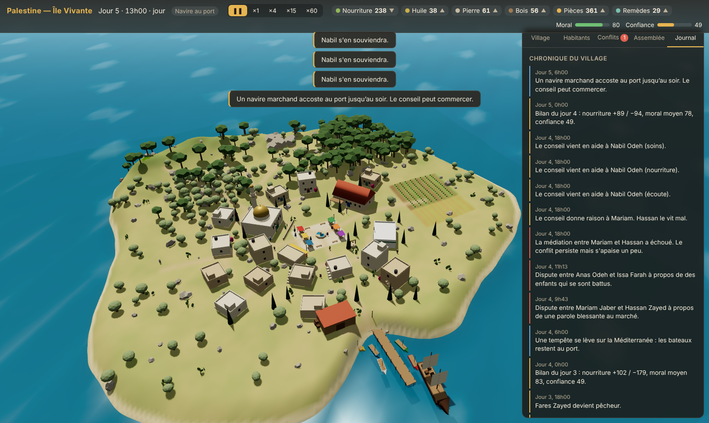

# Palestine — Île Vivante



Simulation 3D en français (Three.js) : vous êtes le **conseil** d'un village fictif de 50 habitants sur une île côtière méditerranéenne. Vous ne contrôlez pas les habitants : vous les observez et vous décidez.

> Simulation crédible de comportement et de mémoire — pas une conscience réelle. Tous les habitants sont fictifs.

## Lancer le prototype

Aucune dépendance à installer (Three.js r170 est embarqué dans `vendor/`).

```bash
cd palestine-ile-vivante
npm start          # serveur statique sur http://localhost:8080
npm test           # simulation headless : 6 jours de jeu + invariants + sauvegarde
```

Paramètres d'URL : `?graine=1234` (autre île / autre population), `?direct` (passe l'écran d'accueil).

## Ce que contient ce prototype

**L'île en 3D** — relief procédural, mer animée, cycle jour/nuit (ciel, soleil, étoiles, fenêtres et lampadaires allumés la nuit), tempêtes. Maisons en pierre à toits plats, mosquée avec dôme et minaret, école, dispensaire, atelier, marché avec étals et fontaine, port avec jetée et barques, carrière, oliveraie, champs, pinède, cyprès, figuiers de Barbarie, plage, source, belvédère.

**50 habitants** répartis en 14 familles, chacun avec :
- nom, âge, foyer, famille ;
- personnalité (7 traits : sociabilité, ardeur, générosité, tempérament, patience, curiosité, piété) ;
- besoins (satiété, énergie, vie sociale, santé), moral, confiance envers le conseil ;
- métier actuel et métier rêvé ;
- routine : IA par utilité (dormir, manger, travailler, école, prier, se soigner, flâner, jouer, rendre visite, faire la fête) modulée par l'heure, les besoins, la personnalité, la météo et les décisions du conseil ;
- déplacements réels sur une grille de navigation (A*), bâtiments et mer évités, jetée praticable ;
- relations (affinité et familiarité avec chacun des 49 autres) : conversations, amitiés, disputes, entraide spontanée ;
- **mémoire simulée** : souvenirs datés avec valence et importance, qui s'estompent (les marquants résistent), influencent les relations et circulent par **bouche-à-oreille** (rumeurs). Les habitants se souviennent de ce que fait le conseil.

**Le panneau de gestion**
- *Village* : statistiques, répartition des métiers, rations, chantiers (puits, maison, jetée, école), commerce avec les navires marchands, courbes, sauvegarde.
- *Habitants* : liste filtrable ; fiche détaillée (pensée du moment, besoins, personnalité, famille, relations, souvenirs) ; changer de métier ; écouter, nourrir, soigner, accorder un jour de repos ; suivre à la caméra.
- *Conflits* : médiation (chance selon patience et confiance), donner raison à l'un, dédommager, ignorer. Un conflit ignoré s'envenime et les familles prennent parti.
- *Assemblée* : un soir sur deux, une question collective ; les adultes votent selon leur personnalité, le conseil tranche — avec ou contre la majorité, et chacun s'en souvient.
- *Journal* : la chronique du village.

## Commandes

Glisser : tourner · clic droit : se déplacer · molette : zoom · clic : sélectionner · double-clic : suivre · `Espace` : pause · `1`–`4` : vitesse · `Échap` : désélectionner.

## Architecture

```
src/
  sim/        moteur de simulation, indépendant du rendu (tourne dans Node)
    simulation.js  temps, économie, décisions, vie sociale, assemblée, chantiers, sauvegarde
    villager.js    habitant : besoins, relations, mémoire, pensées
    navigation.js  grille + A*
    data.js        noms, métiers, motifs de dispute, propositions, chantiers
  world/      relief procédural et plan du village (partagés sim/rendu)
  render/     Three.js : environnement, terrain + végétation, bâtiments, habitants
  ui/         interface de gestion
tests/        test headless de la simulation
```
